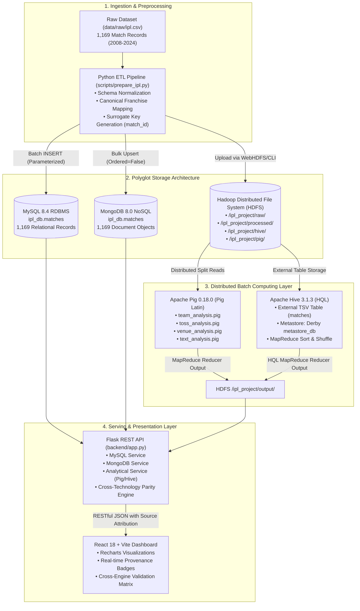

# System Architecture & Technical Design Document

**Project Title:** IPL Team, Toss & Venue Performance Analysis Using Big Data Technologies  
**Environment:** WSL 2 Ubuntu Linux, OpenJDK 8 (`1.8.0_504`), Hadoop 3.4.3, Apache Pig 0.18.0, Apache Hive 3.1.3, MySQL 8.4 RDBMS, MongoDB 8.0 NoSQL, Python 3.14 / Flask, React / Vite  
**Dataset Scale:** 1,169 Official Match Records (Seasons 2008–2024)

---

## 1. Architectural Overview & Design Philosophy

The system implements a modified **Lambda Architecture** tailored for heterogeneous Big Data analytics and multi-model operational serving. The design separates long-term immutable distributed storage and batch computation from low-latency serving and interactive exploratory interfaces:

1. **Distributed Immutable Storage Layer (HDFS):** Stores raw CSV, cleaned TSV/CSV datasets, and intermediate MapReduce output partitions with replication and fault tolerance.
2. **Batch Computing Layer (Apache Pig & Apache Hive):** Executes distributed MapReduce jobs across HDFS data blocks to compute high-cardinality aggregations, win ratios, and venue statistics.
3. **Serving & Relational Query Layer (MySQL 8.4):** Provides ACID-compliant relational schemas, surrogate key indexing, and analytical ANSI SQL queries.
4. **Document NoSQL Layer (MongoDB 8.0):** Provides flexible schema, semi-structured JSON document representations, compound B-tree indexing, and multi-stage aggregation pipelines.
5. **API & Presentation Layer (Flask & React):** Serves RESTful endpoints with provenance tagging and renders responsive, interactive charts with explicit Big Data source attribution.

---

## 2. End-to-End System Architecture Diagram

---

## 3. Data Processing & Compute Layers

### 3.1. Apache Pig Latin Execution Flow
Apache Pig abstracts complex MapReduce Java code into declarative Pig Latin statements:
1. **LOAD:** Loads delimited records from HDFS using `PigStorage('\t')` specifying typed schemas.
2. **FILTER & FOREACH:** Projects required attributes and cleans empty or no-result matches.
3. **GROUP BY:** Shuffles and partitions records by team or stadium name across reducer tasks.
4. **FOREACH & GENERATE:** Calculates aggregated metrics such as counts, sums, and win ratios.
5. **STORE:** Persists tab-delimited partitions into HDFS `/ipl_project/pig/`.

### 3.2. Apache Hive Warehouse Execution Flow
Apache Hive allows SQL practitioners to query HDFS data through HiveQL:
1. **EXTERNAL TABLE:** Points directly to `/ipl_project/hive/matches/` ensuring the underlying HDFS data remains decoupled from the metastore lifecycle.
2. **SERDE & DELIMITER:** Configured with `\t` field delimiter and `\n` line delimiter for high-performance reading.
3. **QUERY PLANNER:** Translates HQL statements into directed acyclic graphs (DAGs) of MapReduce stages.
4. **LOCAL JOB RUNNER OPTIMIZATION:** Configured with `mapreduce.task.io.sort.mb=20` and `HADOOP_HEAPSIZE=2048` to run in single-node WSL 2 environments without JVM heap exhaustion.

---

## 4. Polyglot Persistence Design

| Database / Storage | Role in Pipeline | Storage Model | Primary Advantage in Project |
| :--- | :--- | :--- | :--- |
| **Hadoop HDFS** | Master Immutable Store | Distributed Append-Only Blocks | Fault-tolerant persistence across raw and processed states. |
| **MySQL 8.4** | Relational Analytics & SQL | Relational Tables (InnoDB) | Strict relational integrity, foreign key readiness, ANSI SQL indexing. |
| **MongoDB 8.0** | Semi-Structured Document Store | Hierarchical JSON / BSON | Rich nested objects for players, toss metadata, and dynamic aggregations. |
| **Apache Hive Metastore** | Distributed Data Warehouse | Derby Embedded Catalog | Schema-on-Read over distributed HDFS files for analytical SQL. |

---

## 5. Security & Cross-Engine Validation Pipeline

To ensure computational consistency between distributed batch frameworks (Pig, Hive) and operational engines (MySQL, MongoDB), the pipeline incorporates an automated reconciliation step (`scripts/validate_results.py`):
- Team win counts across all 10 major franchises are verified for **100% mathematical parity**.
- The overall coin-toss advantage metric (600 toss-winner wins / 1,169 matches = 51.33%) is verified to be identical across all four independent computing layers.
